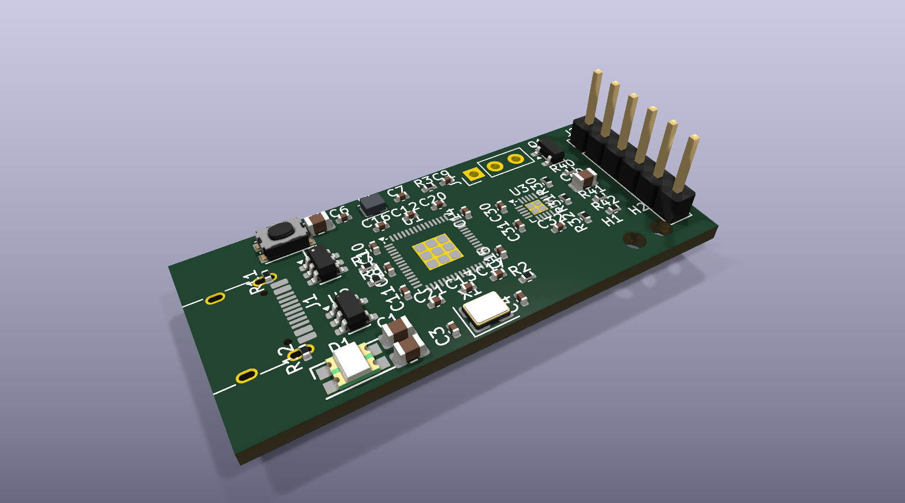

# Cardea Key — hardware (rev A, draft)

> **Work in progress. Not manufactured, not validated.** This is the first draft of Cardea Key's
> own board: the schematic passes KiCad's ERC, and the parts are placed but **not routed yet**.
> It will not be manufactured until the full prototype (Pico 2 + real SE051C2 + fingerprint
> sensor) has been validated. Do not order it.



| | |
|---|---|
| MCU | Raspberry Pi **RP2354A** (RP2350 with 2 MB flash inside) |
| Secure element | NXP **SE051C2** on I2C0 (GP4 SDA, GP5 SCL), with enable (GP6) and reset (GP7) from the MCU |
| Fingerprint sensor | off-board **R502-F Pro**, wires soldered into six 2.54 mm through holes (optional SH1.0 connector in parallel) |
| USB | USB-C receptacle (16 pins) on the board edge, VBUS TVS |
| Power | Diodes AP2112K-3.3 LDO |
| Board | 4 layers, 1.6 mm, about 45 × 20 mm, no screw holes (held by a 3D-printed case) |
| User interface | one push button (C&K KMR2) and an RGB LED; BOOTSEL; SWD on three 2.54 mm holes |

The RP2354A core (core regulator, crystal, decoupling, USB and BOOTSEL) follows Raspberry Pi's
**"RP2350A Minimal"** reference design (© Raspberry Pi Ltd, MIT licence) and the "Hardware design
with RP2350" guide.

## Files

- [`cardea-pcb-schematic-revA.pdf`](cardea-pcb-schematic-revA.pdf): the schematic.
- `cardea-pcb/`: the KiCad 10 project. `cardea-pcb.kicad_sch` is **generated** by
  `tools/gen_schematic.py` from a parts-and-nets table, so the netlist is exactly that table.
  `cardea-pcb.kicad_pcb` is the placement draft from `tools/gen_board.py`. `lib/cardea.kicad_sym`
  holds the SE051C2 symbol, drawn from its datasheet pin table.
- `tools/kicad_lib.py`: reads KiCad library symbols and their pins without KiCad's Python API.
- `images/`: renders of the current draft ([top](images/cardea-pcb-top.png),
  [bottom](images/cardea-pcb-bottom.png)).

```sh
python3 hardware/tools/gen_schematic.py
kicad-cli sch erc --severity-all hardware/cardea-pcb/cardea-pcb.kicad_sch      # must report 0
```

## Licence

The hardware design files in this directory are licensed under the
**CERN Open Hardware Licence Version 2 – Strongly Reciprocal** ([CERN-OHL-S-2.0](LICENSE)).
The firmware and the tools elsewhere in this repository stay under AGPL-3.0.

Symbols and footprints come from the official KiCad libraries (CC-BY-SA 4.0 with their exception
for designs), except the SE051C2 symbol, which is our own.
